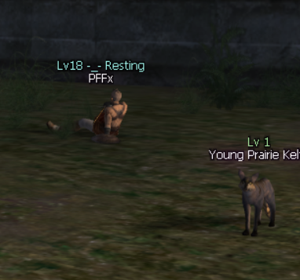

# L2Solo - solo fork

A personal fork of **[pmbstyle/L2Solo](https://github.com/pmbstyle/L2Solo)**, the Lineage II C4 (Scions of Destiny) local server with a living bot world. This fork is played solo, and its changes make the bots more human and solo play smoother. Everything stays in Chronicle 4: nothing from C5 or Interlude.

- `solo` (this branch): upstream `develop` plus every change listed below
- `main` and `develop`: untouched mirrors of upstream
- `fix/...` and `feat/...`: one change each, written so it can go back upstream as a PR
- `mine/...`: personal changes for solo play

Every setting below is optional. They go in `config/local.ini`, which git ignores; create the file if you don't have it.

## Living bots in game

The goal: bots that feel like people. Each one has its own personality, remembers you, wants things, reacts to what happens around it and gets smarter over time. The title above every bot shows its level, a face for what it thinks of you, and what it needs or is doing, live. Every shot is from real play.

**Out hunting.** A stranger shows what it's doing. When you take a bot's mob, it tells you so.

**It comes for you, and its face says so.**

**A fight draws a watcher, while the others keep hunting.**

**After the fight, each one says what it needs:** one wants a heal, one lies dead asking for a res, and the watcher is still watching.

**Taking a break, and heading out to its spot.**

 

**Pick a fight with a group, and they all come for you** (the one-word style, `moodTitleFaces = false`).

All the bot AI mods together, with one install block: [Living Bots](https://github.com/Arturas-Salivonas/L2Solo/blob/feat/living-bots/solo/guides/LIVING_BOTS.md).

## All modifications

**Want only some of them on your own L2Solo?** Each one installs on its own: [L2Solo mods: take only what you want](../solo/guides/MODS.md).

### 1. Solo Helper on Alt+B (`mine/solo-buffer`)
A full-width Community Board window for solo play. [Install guide for other servers](https://github.com/Arturas-Salivonas/L2Solo/blob/mine/solo-buffer/solo/guides/SOLO_HELPER.md).
- **Buffer tab:**
  - 85 C4 buffs at max level plus the 4 summoner servitor buffs (Blessing and Gift of Queen, Blessing and Gift of Seraphim), in 7 tabs with skill icons.
  - Presets: Tank, Fighter, Mage, Support and My set.
  - Every buff lasts 60 minutes and survives a relog or a server restart.
  - Full HP/MP/CP in one click, your servitor's HP and MP too.
- **Buff slots:** 20 as in C4, or up to 28 for you. Bots keep 20.
- **Adena tab:** quick buttons from +10k to +1kkk, any typed amount (`250k`, `5kk`, `1b`), or `.adena 5kk` in chat.
- **Class tab:** change class at level 20, 40 and 76 without the quests, from your race's C4 class tree (your path marked, cards for the next classes, a confirm step). `.class` in chat opens it.
- **Market Board** is one tab away. `.buffer` in chat opens the window too.
- **Settings** (`[SoloHelper]`): `enabled`, `altB`, `buffMinutes`, `window`, `adena`, `classChange`, `buffSlots`.

### 2. Living Bots: all the bot AI in one mod (`feat/living-bots`)
Bots that feel like people: [guide, screenshots and one install](https://github.com/Arturas-Salivonas/L2Solo/blob/feat/living-bots/solo/guides/LIVING_BOTS.md).
- **Mood titles:** every bot's title shows its level, a face for what it thinks of you and what it needs or does: `Lv20 :) Hunting`, `Lv31 >:( Attacks`, `Lv14 Res pls`, `Lv15 To spot`.
- **Moments:** bots near you say thanks for a heal, buff or res, "ding" on a level-up and "nice drop!" in local chat.
- **Allies jump in:** attack a bot and its clanmates, friends, a justice-minded bot (if you're a PK) or now and then a stranger may take its side; each checks it can win, at most 3 join. Bots that like you defend you, and a hurt bot calls for help.
- **Gossip, fear and bravado:** PK a bot and the town hears of it; bots grow wary of you, then afraid, and some back away while bold ones talk back. Help bots and strangers start out friendlier.
- **Revenge, PK bots, manhunts:** bots act on grudges once you come close; PvP-minded bots (level 20+) pick on lone, busy or hurt players; a bot you kill may come back for you.
- **Rivalries:** kill-steals and kills between bots become grudges: arguments when they meet, sometimes a fight.
- **Town attention:** gz when you level up, PKs called out by name, fights draw watchers.
- **Free loot, word of mouth:** bots pick up ownerless items, and trusted bots share their best spots.
- **Smarter hunting:** bots hunt monsters within 5 levels below them (parties up to 5 above too), leave grey ground for the spot they chose, and a bot that died at a spot twice warns its friends.
- **World legacy:** a bot wipe saves what the world learned; the same bots come back and remember players by name.
- **Settings** (`[BotPopulation]`): `botMoodTitles`, `moodTitleFaces`, `botMoments`, `allyDefenseEnabled`, `allyDefenseRate`, `gossipEnabled`, `nerveEnabled`, `rivalriesEnabled`, `spotDangerEnabled`, `legacyFeelingsEnabled`, `pkBotsEnabled`, `pkRate`, `pkMinLevel`, `manhuntEnabled`, `manhuntRate`, `manhuntMinutes`, `freeLootEnabled`, `townAttentionEnabled`, `wordOfMouthEnabled`, `worldLegacyEnabled`.

### 3. Starter villages sell the C4 robe set (`fix/starter-village-robes`)
Jackson (Talking Island), Payne (Elven Village) and Ariel (Dark Elven Village) now sell the ten No-Grade robe pieces at C4 prices, as the Orc and Dwarven villages already did. Checked against two C4 server datapacks, Lisvus and L2J Mobius. [Guide](https://github.com/Arturas-Salivonas/L2Solo/blob/fix/starter-village-robes/solo/guides/STARTER_ROBES.md).

### 4. Closing the server window saves the world (`fix/console-close-drain`)
A bug fix. Closing the console window used to kill the server before it saved, losing recent progress. Now closing the window saves first, like Stop and Ctrl+C. [Guide](https://github.com/Arturas-Salivonas/L2Solo/blob/fix/console-close-drain/solo/guides/CONSOLE_CLOSE.md).

### 5. Buffs survive a server restart (`fix/shutdown-saves-player-status`)
A bug fix. A server stop never saved the players still online, so after a restart you logged in with no buffs and your HP and MP from your last logout. Now the stop saves every online player first, and a saved buff keeps the time it had left: as in C4, the clock doesn't run while you're offline. [Guide](https://github.com/Arturas-Salivonas/L2Solo/blob/fix/shutdown-saves-player-status/solo/guides/RESTART_BUFFS.md).

### 6. Same-kind buffs replace each other (`fix/buff-stack-groups`)
A bug fix. In C4 two buffs of one kind can't be on you at once, but this server left 21 kinds without that rule: Focus stacked with Chant of Predator, Death Whisper with Chant of Rage, Vampiric Rage with Chant of Vampire, and more. Now the new one replaces the old unless the old is stronger, by C4's own levels (from the L2J Mobius C4 datapack). [Guide](https://github.com/Arturas-Salivonas/L2Solo/blob/fix/buff-stack-groups/solo/guides/BUFF_STACKING.md).

### 7. One-click Play (`solo/Play L2Solo.cmd`)
Double-click it to open the browser launcher and start the server at your last rate. `npm run start` still works the same.

### 8. Fork tools (`solo/fork.js`)
`status`, `sync`, `new`, `land`, `pr`, `backup` and `restore` keep upstream updates and these changes apart, and never lose work. See [solo/README.md](../solo/README.md).

## Changelog

### 2026-11-27
- **Solo Helper:** Class tab - change class at 20, 40 and 76 from the C4 class tree, or `.class` in chat.
- **Fix:** same-kind buffs (Focus and Chant of Predator, Death Whisper and Chant of Rage, Vampiric Rage and Chant of Vampire...) replace each other, as in C4.
- **Living Bots:** bots hunt within 5 levels below them (parties up to 5 above), leave grey ground, and take no spot or easy fights on it; WTB/WTS demand removed; all the bot mods in one place, guides in each mod's branch.
- **Living Bots:** one mod for all the bot AI, plus allies, friends defending you, calls for help, gossip, fear and bravado, rivalries, smarter party spots, spot warnings and feelings across a wipe.
- **Fix:** a server stop saves online players' HP, MP, CP and buffs, and a saved buff keeps its time left while you're offline, as in C4.
- **Solo Helper:** Full HP/MP/CP button, the Active row and My class preset gone, the Dominator buffs in the Overlord tab, Chant of Victory in Special.
- **Mood titles:** faces, what a bot needs, where it really is (no more "Hunting" while standing in town), and moments in chat.
- **Mood titles** show live state and activity (Fights you, Angry, Hunting, Looting) instead of mostly Neutral.
- **Mood titles:** level and opinion above every bot.
- **Solo Helper:** buff slots fall back safely to 20 on hand installs.
- **Solo Helper:** the 4 summoner servitor buffs in a new Special tab, plus buff slots up to 28.
- **World legacy:** bots remember across a wipe.
- **Starter villages** sell the C4 robe set.
- **Word of mouth:** bots share hunting spots.
- **WTB lines** count as market demand.
- **Town attention:** gz, PK calls, fight watchers, and the restless-mood fix.
- **Free loot:** bots pick up ownerless items.
- **Solo Helper:** board buttons at the width the C4 client draws.
- **Bot vendettas:** the revenge fix, PK bots, personal manhunts and the walk-up.
- **Solo Helper:** Adena tab.
- **Fix:** closing the server window saves the world.
- **One-click Play** launcher.
- **Solo Helper:** full-width Community Board with skill icons.
- **Solo Helper:** first version (Alt+B buffer).
- **Fork workflow:** solo branch, fork tool, C4 reference and bot AI docs.

## Upstream

- **The good changes go back upstream as PRs.** Their PR texts are ready in [solo/prs/](../solo/prs/).
- **Blocked for now:** pmbstyle/L2Solo currently accepts PRs only from prior contributors, so they wait for the maintainer to open that up.

**Guides**
- [Living Bots: bots that feel like people](https://github.com/Arturas-Salivonas/L2Solo/blob/feat/living-bots/solo/guides/LIVING_BOTS.md). The bot AI mods together: what they do, screenshots, one install block and the plans.
- [L2Solo mods: take only what you want](../solo/guides/MODS.md). Every modification with its own install line and patch link.
- [Solo Helper: 1-hour buffs, Adena and class change on Alt+B](https://github.com/Arturas-Salivonas/L2Solo/blob/mine/solo-buffer/solo/guides/SOLO_HELPER.md). A buffer, Adena and class change window for solo play, with install steps for any L2Solo copy.

**Workflow and tools:** [solo/README.md](../solo/README.md)
**Upstream's README** (download, setup, in-game commands): [README.md](../README.md)

All credit for L2Solo goes to its authors. This fork follows the same Apache 2.0 license.
