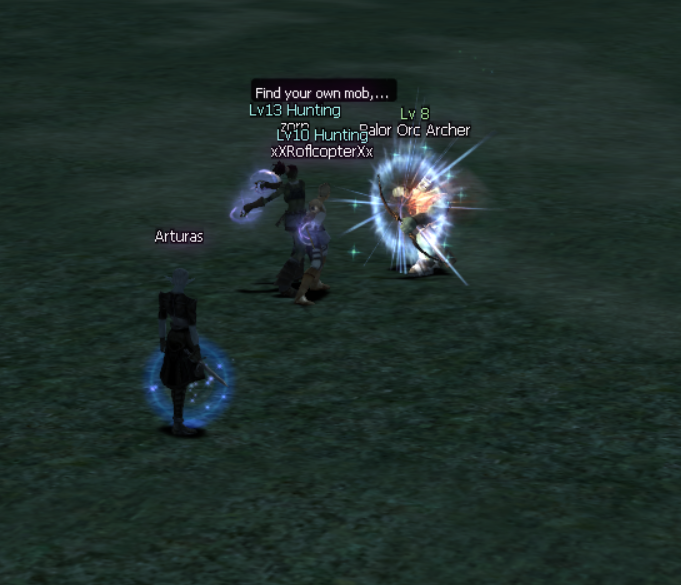
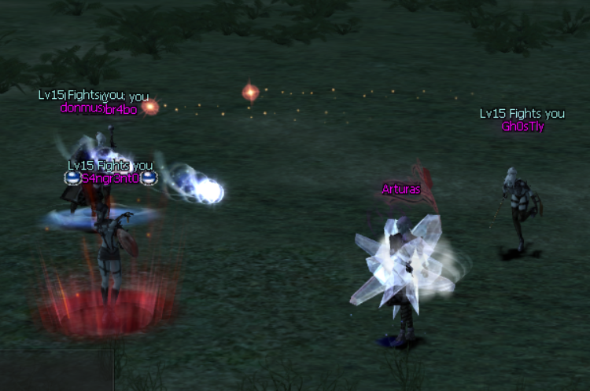

# L2Solo - solo fork

A personal fork of **[pmbstyle/L2Solo](https://github.com/pmbstyle/L2Solo)**, the Lineage II C4 (Scions of Destiny) local server with a living bot world. This fork is played solo, and its changes make the bots more human and solo play smoother. Everything stays in Chronicle 4: nothing from C5 or Interlude.

- `solo` (this branch): upstream `develop` plus every change listed below
- `main` and `develop`: untouched mirrors of upstream
- `fix/...` and `feat/...`: one change each, written so it can go back upstream as a PR
- `mine/...`: personal changes for solo play

Every setting below is optional. They go in `config/local.ini`, which git ignores; create the file if you don't have it.

## Living bots in game

The goal: bots that feel like people. Each one has its own personality, remembers you, wants things, reacts to what happens around it and gets smarter over time. The title above every bot shows its level, a face for what it thinks of you, and what it needs or is doing, live. Every shot is from real play.

**Out hunting.** A stranger shows what it's doing. When you take a bot's mob, it tells you so.

**It comes for you, and its face says so.**

**A fight draws a watcher, while the others keep hunting.**

**After the fight, each one says what it needs:** one wants a heal, one lies dead asking for a res, and the watcher is still watching.

**Taking a break, and heading out to its spot.**

 

**Pick a fight with a group, and they all come for you** (the one-word style, `moodTitleFaces = false`).

All the bot AI mods together, with one install block: [Living Bots](../solo/guides/LIVING_BOTS.md).

## All modifications

**Want only some of them on your own L2Solo?** Each one installs on its own: [L2Solo mods: take only what you want](../solo/guides/MODS.md).

### 1. Solo Helper on Alt+B (`mine/solo-buffer`)
A full-width Community Board window for solo play. [Install guide for other servers](../solo/guides/SOLO_HELPER.md).
- **Buffer tab:**
  - 85 C4 buffs at max level plus the 4 summoner servitor buffs (Blessing and Gift of Queen, Blessing and Gift of Seraphim), in 7 tabs with skill icons.
  - Presets: Tank, Fighter, Mage, Support and My set.
  - Every buff lasts 60 minutes and survives a relog or a server restart.
  - Full HP/MP/CP in one click, your servitor's HP and MP too.
- **Buff slots:** 20 as in C4, or up to 28 for you. Bots keep 20.
- **Adena tab:** quick buttons from +10k to +1kkk, any typed amount (`250k`, `5kk`, `1b`), or `.adena 5kk` in chat.
- **Market Board** is one tab away. `.buffer` in chat opens the window too.
- **Settings** (`[SoloHelper]`): `enabled`, `altB`, `buffMinutes`, `window`, `adena`, `buffSlots`.

### 2. Living Bots: all the bot AI in one mod (`feat/living-bots`)
Everything in 3 to 11 below, plus:
- **Allies jump in:** attack a bot and its clanmates, friends, a justice-minded bot (if you're a PK) or now and then a stranger may take its side. Each checks it can win; at most 3 join.
- **Friends defend you:** bots that like you help when a PK or another bot attacks you.
- **Calls for help:** a bot under half HP shouts "help!", and its clan and friends come from farther away.
- **Gossip:** PK a bot and the town hears of it; bots grow wary of you, then afraid, before they ever meet you. Help bots and strangers start out friendlier.
- **Fear and bravado:** an afraid bot backs away from you; a bold one with a grudge says so to your face.
- **Rivalries:** kill-steals and kills between bots become grudges: arguments when they meet, sometimes a fight.
- **Smarter party spots:** a party hunts where its level fits, and moves on once its spot drops below its level band (no more level-18 parties on level-7 monsters).
- **Spot warnings:** a bot that died at a spot twice warns its friends, who keep away too.
- **Feelings across a wipe:** a returning bot remembers a player of the same name.
- **One install:** [Living Bots guide](../solo/guides/LIVING_BOTS.md).
- **Settings** (`[BotPopulation]`): `allyDefenseEnabled`, `allyDefenseRate`, `gossipEnabled`, `nerveEnabled`, `rivalriesEnabled`, `spotDangerEnabled`, `legacyFeelingsEnabled`, plus the ones below.

### 3. Bot mood titles and moments (`feat/bot-mood-titles`)
Every bot's title shows its level, a face for what it thinks of you, and one word for what it needs or does: `Lv20 :) Hunting`, `Lv31 >:( Attacks`, `Lv14 o_O LFP`.
- **Faces:** `>:(` fights you or hates you, `>:|` grudge, `o_O` afraid, `-_-` wary, `:)` friendly, `^_^` friend, `:D` party. No face for a stranger.
- **What it needs:** Res pls (dead), Heal me, Selling, No MP, Heavy (full bag), LFP.
- **What it does, where it really is:** Fights (a monster), To spot, Roaming, No mobs, Stuck, Chats, Looting, Watches, To town, Resting, Buying, Fleeing.
- **Standing about:** its gear goal (Saving, Farming, Gathers) or its own mood (Tired, Bored, Chill), else AFK.
- **Moments in chat:** bots near you say thanks for a heal, buff or res, "ding" on a level-up, and "nice drop!" for a graded or valuable item. At most one line a minute per bot.
- **Updates:** within about 2.5 s of a change.
- **Settings** (`[BotPopulation]`): `botMoodTitles`, `moodTitleFaces` (false = one word, like `Lv20 Fights you`), `botMoments`.

### 4. Revenge that actually happens (`feat/bot-vendettas`)
A bug fix. A bot decides at first sight whether to settle a grudge, but you were usually still too far away, so the decision was thrown away. Now it waits until you come within reach, with the same odds as before.

### 5. PK bots from the population (`feat/bot-vendettas`)
No scripted PKers: ordinary bots whose personality leans to PvP.
- **Who:** both of you at level 20 or more, the victim at most 8 levels below the bot and 2 above, and alone. A brawler means it on about 1 hunting stay in 5, a justice keeper almost never.
- **When:** it waits until you're busy fighting, sitting or under 60% HP, walks up and attacks if it thinks it can win.
- **After a kill** it turns red and washes its karma before it tries again.
- **Settings** (`[BotPopulation]`): `pkBotsEnabled`, `pkRate`, `pkMinLevel`.

### 6. Personal manhunts (`feat/bot-vendettas`)
A bot you kill may swear revenge out loud, go back to where it died for 2 hours, walk up when it sees you and attack. Brawlers do it about half the time, an average bot about 1 in 20, and every further kill makes it likelier.
- **Settings:** `manhuntEnabled`, `manhuntRate`, `manhuntMinutes`.

### 7. Free loot (`feat/free-loot`)
Bots pick up items nobody owns: your drops, PK drops, and monster drops left by their owners for 15 seconds. Greedy personalities do it more, and only one bot goes for each item.
- **Setting:** `freeLootEnabled`.

### 8. Town attention (`feat/town-attention`)
- **Level-ups:** up to 3 bots say "gz" when you level up.
- **PKs:** bystanders call out a PK by name.
- **Fights:** a fight draws up to 3 watchers who walk over, and sometimes one says "gg".
- **Fix:** the bots' "restless" mood never fired before; now it does.
- **Setting:** `townAttentionEnabled`.

### 9. Your WTB lines are market demand (`feat/player-trade-shouts`)
"WTB Cotton Tunic x10" in local, shout or trade chat counts as demand in the nearest town, so crafters stock and bid for it. Each item counts once every 10 minutes per player.
- **Setting:** `playerTradeShoutsEnabled`.

### 10. Word of mouth (`feat/word-of-mouth`)
Two bots that trust each other (clan, party or friends) share their best hunting spot out loud when they meet in town near you. The one doing worse goes to try it once.
- **Setting:** `wordOfMouthEnabled`.

### 11. World legacy: bots remember across a wipe (`feat/world-legacy`)
- **Saved automatically:** every bot wipe first saves `tmp/legacy/world-legacy.json`.
- **The same people come back:** the new world's bots are the old ones, with the same names and personalities and their know-how, at level 1 with starter gear.
- **Spot lessons:** what bots really earned on each spot corrects the spot table's guesses.
- **Feelings toward you** are saved, ready for a later step.
- **By hand:** `node scripts/world-legacy.js save` or `show`.
- **Setting:** `worldLegacyEnabled`.

### 12. Starter villages sell the C4 robe set (`fix/starter-village-robes`)
Jackson (Talking Island), Payne (Elven Village) and Ariel (Dark Elven Village) now sell the ten No-Grade robe pieces at C4 prices, as the Orc and Dwarven villages already did. Checked against two C4 server datapacks, Lisvus and L2J Mobius.

### 13. Closing the server window saves the world (`fix/console-close-drain`)
A bug fix. Closing the console window used to kill the server before it saved, losing recent progress. Now closing the window saves first, like Stop and Ctrl+C.

### 14. Buffs survive a server restart (`fix/shutdown-saves-player-status`)
A bug fix. A server stop never saved the players still online, so after a restart you logged in with no buffs and your HP and MP from your last logout. Now the stop saves every online player first, and a saved buff keeps the time it had left: as in C4, the clock doesn't run while you're offline.

### 15. One-click Play (`solo/Play L2Solo.cmd`)
Double-click it to open the browser launcher and start the server at your last rate. `npm run start` still works the same.

### 16. Fork tools (`solo/fork.js`)
`status`, `sync`, `new`, `land`, `pr`, `backup` and `restore` keep upstream updates and these changes apart, and never lose work. See [solo/README.md](../solo/README.md).

## Changelog

### 2026-11-27
- **Living Bots:** one mod for all the bot AI, plus allies, friends defending you, calls for help, gossip, fear and bravado, rivalries, smarter party spots, spot warnings and feelings across a wipe.
- **Fix:** a server stop saves online players' HP, MP, CP and buffs, and a saved buff keeps its time left while you're offline, as in C4.
- **Solo Helper:** Full HP/MP/CP button, the Active row and My class preset gone, the Dominator buffs in the Overlord tab, Chant of Victory in Special.
- **Mood titles:** faces, what a bot needs, where it really is (no more "Hunting" while standing in town), and moments in chat.
- **Mood titles** show live state and activity (Fights you, Angry, Hunting, Looting) instead of mostly Neutral.
- **Mood titles:** level and opinion above every bot.
- **Solo Helper:** buff slots fall back safely to 20 on hand installs.
- **Solo Helper:** the 4 summoner servitor buffs in a new Special tab, plus buff slots up to 28.
- **World legacy:** bots remember across a wipe.
- **Starter villages** sell the C4 robe set.
- **Word of mouth:** bots share hunting spots.
- **WTB lines** count as market demand.
- **Town attention:** gz, PK calls, fight watchers, and the restless-mood fix.
- **Free loot:** bots pick up ownerless items.
- **Solo Helper:** board buttons at the width the C4 client draws.
- **Bot vendettas:** the revenge fix, PK bots, personal manhunts and the walk-up.
- **Solo Helper:** Adena tab.
- **Fix:** closing the server window saves the world.
- **One-click Play** launcher.
- **Solo Helper:** full-width Community Board with skill icons.
- **Solo Helper:** first version (Alt+B buffer).
- **Fork workflow:** solo branch, fork tool, C4 reference and bot AI docs.

## Upstream

- **The good changes go back upstream as PRs.** Their PR texts are ready in [solo/prs/](../solo/prs/).
- **Blocked for now:** pmbstyle/L2Solo currently accepts PRs only from prior contributors, so they wait for the maintainer to open that up.

**Guides**
- [Living Bots: bots that feel like people](../solo/guides/LIVING_BOTS.md). The bot AI mods together: what they do, screenshots, one install block and the plans.
- [L2Solo mods: take only what you want](../solo/guides/MODS.md). Every modification with its own install line and patch link.
- [Solo Helper: 1-hour buffs and Adena on Alt+B](../solo/guides/SOLO_HELPER.md). A buffer and Adena window for solo play, with install steps for any L2Solo copy.

**Workflow and tools:** [solo/README.md](../solo/README.md)
**Upstream's README** (download, setup, in-game commands): [README.md](../README.md)

All credit for L2Solo goes to its authors. This fork follows the same Apache 2.0 license.
