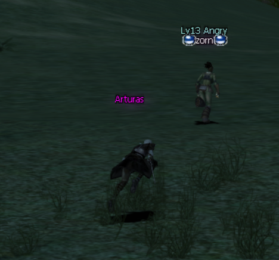

# L2Solo - solo fork

A personal fork of **[pmbstyle/L2Solo](https://github.com/pmbstyle/L2Solo)**, the Lineage II C4 (Scions of Destiny) local server with a living bot world.

- `solo` (this branch): upstream `develop` plus our bug fixes and bot AI work
- `main` and `develop`: untouched mirrors of upstream
- `fix/...`, `feat/...`: single changes. The good ones go back upstream as PRs.

## Living bots: what this fork adds

The title above every bot shows its level and one word about you, live. Every shot below is from real play.

**Out hunting.** A stranger shows what it's doing. When you take a bot's mob, it tells you so.

**Hit one, and it remembers.**

**Pick a fight with a group, and they all come for you.**

**The bot features** (each its own branch, details in [solo/README.md](../solo/README.md)):
- **Mood titles:** Fights you, Hunting you, Angry, Grudge, Friend, Hunting, Resting, Looting and more (`feat/bot-mood-titles`)
- **Revenge, PK bots and manhunts:** bots act on grudges, a few turn PK, and a bot you kill may come back for you (`feat/bot-vendettas`)
- **Free loot:** bots pick up items nobody owns (`feat/free-loot`)
- **Town attention:** "gz" when you level up, bystanders calling out PKs, crowds watching fights (`feat/town-attention`)
- **Word of mouth:** friends share their best hunting spots (`feat/word-of-mouth`)
- **Your WTB lines are market demand** that crafters stock for (`feat/player-trade-shouts`)
- **World legacy:** after a wipe the same bots come back with their personalities and know-how (`feat/world-legacy`)
- **Starter villages sell the C4 robe set** (`fix/starter-village-robes`)

**Guides**
- [Solo Helper: 1-hour buffs and Adena on Alt+B](../solo/guides/SOLO_HELPER.md). A buffer and Adena window for solo play, with install steps for any L2Solo copy.

**Workflow and tools:** [solo/README.md](../solo/README.md)
**Upstream's README** (download, setup, in-game commands): [README.md](../README.md)

All credit for L2Solo goes to its authors. This fork follows the same Apache 2.0 license.
