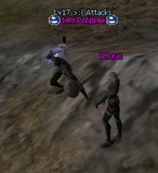
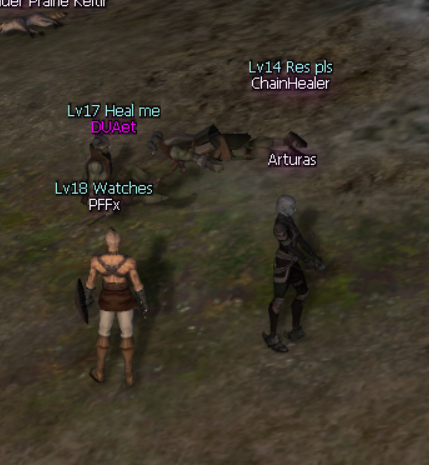
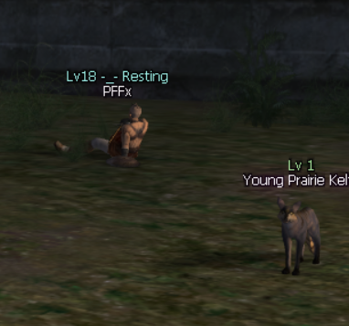

# Living Bots for L2Solo: bots that feel like people

[L2Solo](https://github.com/pmbstyle/L2Solo) already fills the world with about 1,700 bots that level, trade, party and fight. This mod set makes them feel less like scripts and more like the players you remember from C4.

**The goal:** every bot is its own person. It has a personality, remembers how you treated it, wants things, reacts to what happens around it, talks like a player and gets smarter over time. All of it stays in Chronicle 4.

It's a work in progress, and it grows one piece at a time. Each piece is its own mod, so you can take only the ones you like.

## What you see in game

**Titles that say what a bot thinks and does.** Every bot's title shows its level, a face for its opinion of you, and one word for what it needs or does, live:

 

- **Faces:** `>:(` angry with you, `>:|` holds a grudge, `o_O` afraid, `-_-` wary, `:)` friendly, `^_^` a friend, `:D` your party. A stranger has no face.
- **Needs:** `Res pls`, `Heal me`, `No MP`, `Heavy`, `LFP`, `Selling`.
- **Doing:** `Fights`, `To spot`, `Roaming`, `No mobs`, `Looting`, `Watches`, `Chats`, `To town`, `Resting`.
- **Standing about:** its gear goal (`Saving`, `Farming`, `Gathers`) or its mood (`Tired`, `Bored`, `Chill`), else `AFK`.

 

**Moments.** Bots near you talk in local chat like players do: "ty!" for a heal, "ty for res!!" when you bring one back, "ding!" on a level-up, "nice drop!" for a good item.

**They remember.**
- Hit a bot and it gets angry. Kill one and it may swear revenge, wait where it died and come back for you.
- A few bots with a PvP streak turn PK: they wait until you're busy or hurt, walk up and attack.
- Two bots that trust each other share their best hunting spot when they meet in town.

**They notice you.**
- Level up and up to 3 bots say "gz". A PK gets called out by name.
- A fight draws watchers, and sometimes a "gg".


**They use the world.**
- Bots pick up items nobody owns: your drops, PK drops, loot left on the ground.
- Your "WTB Cotton Tunic x10" in chat counts as market demand, so crafters stock it.

**They come back smarter.** A bot wipe first saves what the world learned. The next world's bots are the same people, with the same names, personalities and know-how, at level 1. What they earned on each hunting spot corrects their spot guesses.

## The mods

| Mod | What it adds | Branch |
|---|---|---|
| Mood titles and moments | Titles with faces, needs and doings; chat moments | `feat/bot-mood-titles` |
| Bot vendettas | Revenge that happens, PK bots, personal manhunts | `feat/bot-vendettas` |
| Free loot | Bots pick up ownerless items | `feat/free-loot` |
| Town attention | gz, PK call-outs, fight watchers | `feat/town-attention` |
| WTB demand | Your WTB lines are market demand | `feat/player-trade-shouts` |
| Word of mouth | Bots share hunting spots | `feat/word-of-mouth` |
| World legacy | Bots remember across a wipe | `feat/world-legacy` |

## Install

Stop your server first. With a cloned L2Solo, run once in your L2Solo folder:

```
git remote add l2mods https://github.com/Arturas-Salivonas/L2Solo.git
git fetch l2mods
```

Then cherry-pick the ones you want. All seven together, in this order:

```
git cherry-pick 27040e379..l2mods/feat/bot-vendettas
git cherry-pick 27040e379..l2mods/feat/free-loot
git cherry-pick 27040e379..l2mods/feat/town-attention
git cherry-pick 27040e379..l2mods/feat/player-trade-shouts
git cherry-pick 27040e379..l2mods/feat/word-of-mouth
git cherry-pick 27040e379..l2mods/feat/world-legacy
git cherry-pick 27040e379..l2mods/feat/bot-mood-titles
```

Checked on L2Solo `main` and `develop` of late November 2026: all seven apply cleanly together, and the tests pass. Patch files and one-by-one installs are in [MODS.md](MODS.md). Restart the server after installing.

## Settings (optional)

Everything is on by default. To change something, add it to `config/local.ini`:

```
[BotPopulation]
botMoodTitles = true            ; titles above bots
moodTitleFaces = true           ; false = one word, like "Lv20 Fights you"
botMoments = true               ; thanks, ding and drop lines in chat
pkBotsEnabled = true            ; PK bots
pkRate = 1                      ; 0 = none, up to 5
pkMinLevel = 20
manhuntEnabled = true           ; bots you kill may come back for you
manhuntRate = 1                 ; 0 = never, up to 5
manhuntMinutes = 120
freeLootEnabled = true
townAttentionEnabled = true
playerTradeShoutsEnabled = true
wordOfMouthEnabled = true
worldLegacyEnabled = true
```

## What's next

- Bots that remember how you treated them even after a wipe (the feelings are already saved, not yet used).
- More moments and reactions, and more personality in how bots talk.
- Bots that learn from what works for them, so each world's bots play a little better than the last.

**Ideas and bugs:** tell me on Discord, or open an issue on <https://github.com/Arturas-Salivonas/L2Solo>. What would make the bots feel more alive to you?

All credit for L2Solo goes to its authors (<https://github.com/pmbstyle/L2Solo>), under the same Apache 2.0 license.
