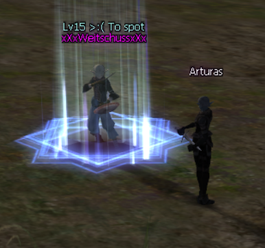
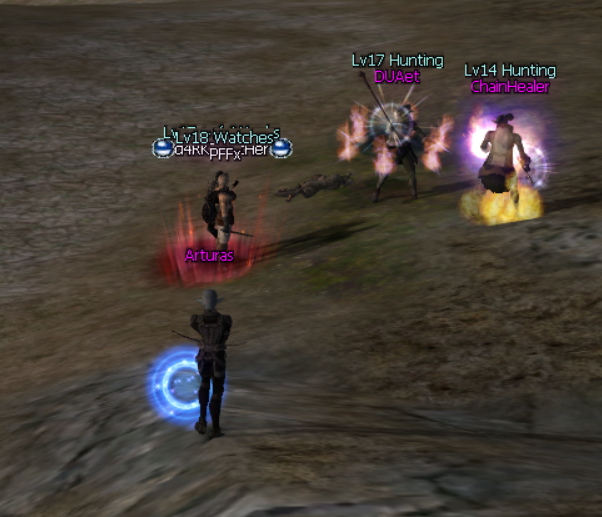

# Living Bots for L2Solo: bots that feel like people

[L2Solo](https://github.com/pmbstyle/L2Solo) already fills the world with about 1,700 bots that level, trade, party and fight. Living Bots makes them feel less like scripts and more like the players you remember from C4.

**The goal:** every bot is its own person. It has a personality, remembers how you treated it, stands up for its friends, talks about you behind your back, holds grudges, learns from what went wrong and gets smarter over time. All of it stays in Chronicle 4.

It's one mod, `feat/living-bots`, and it keeps growing.

## What you see in game

**Titles that say what a bot thinks and does.** Every bot's title shows its level, a face for its opinion of you, and one word for what it needs or does, live:

 

- **Faces:** `>:(` angry with you, `>:|` holds a grudge, `o_O` afraid, `-_-` wary, `:)` friendly, `^_^` a friend, `:D` your party. A stranger has no face.
- **Needs:** `Res pls`, `Heal me`, `No MP`, `Heavy`, `LFP`, `Selling`.
- **Doing:** `Fights`, `To spot`, `Roaming`, `No mobs`, `Looting`, `Watches`, `Chats`, `To town`, `Resting`.
- **Standing about:** its gear goal (`Saving`, `Farming`, `Gathers`) or its mood (`Tired`, `Bored`, `Chill`), else `AFK`.

 

**Moments.** Bots near you talk in local chat like players do: "ty!" for a heal, "ty for res!!" when you bring one back, "ding!" on a level-up, "nice drop!" for a good item.

**They stand up for each other.**
- **Allies jump in.** Attack a bot and others nearby may take its side: its clanmates most of all, then its friends, a justice-minded bot if you're a PK, and now and then a kind, bold stranger. Each one checks it can win first, and at most 3 join. "leave our clanmate alone!"
- **Friends defend you.** A bot that likes you (`^_^`) comes to help when a PK or another bot attacks you.
- **Calls for help.** A bot under half HP shouts "help!", and its clan and friends come from farther away.
- It all follows C4's rules: you turn purple when you hit a white bot, so helpers take no karma, and nobody defends a PK from the player hunting it.

**The world talks about you.**
- **Gossip.** PK a bot and it tells others in town: "careful, Arturas PKs at Cruma". Bots who hear it are wary of you, then afraid, before they ever meet you, and some pass it on. Heal, buff or res bots, and word of that spreads too, so strangers start out friendlier.
- **Fear and bravado.** A bot afraid of you keeps its distance and backs away when you come close ("uh oh"). A bold one with a grudge tells you so: "you again?"

**They remember.**
- Hit a bot and it gets angry. Kill one and it may swear revenge, wait where it died and come back for you.
- A few bots with a PvP streak turn PK: they wait until you're busy or hurt, walk up and attack.
- **Grudges between bots.** Kill-steals and kills between bots turn into rivalries. When rivals meet, they argue ("stay away from my mobs"), the other answers back, and a deep grudge can end in a fight outside town.

**They notice you.**
- Level up and up to 3 bots say "gz". A PK gets called out by name.
- A fight draws watchers, and sometimes a "gg".



**They use the world.**
- Bots pick up items nobody owns: your drops, PK drops, loot left on the ground.
- Your "WTB Cotton Tunic x10" in chat counts as market demand, so crafters stock it.
- Two bots that trust each other share their best hunting spot when they meet in town.

**They get smarter.**
- **Smarter party spots.** A party now hunts where its level fits. Before, a party took the spot where its first member happened to stand and kept it, so a level-18 party could farm level-7 monsters until it was 9 levels over them. Now it moves on as soon as the spot drops below its level band.
- **Spots that killed them.** A bot that died at a spot twice already stays away from it for a while. Now it also warns its friends in town ("stay away from Cruma, I died there twice"), and they keep away too until their next trip back to town.
- **After a wipe.** A bot wipe first saves what the world learned. The next world's bots are the same people, with the same names, personalities and know-how, at level 1. What they earned on each spot corrects their spot guesses, and when they meet a player of the same name again, they remember how they felt: "Arturas... I remember you".

## Install

### Let your AI agent do it

**Don't know how to install it?** Copy this into your AI coding agent (Claude Code, Cursor, Codex or similar) and fill in your folder. It checks your server is stopped, backs up your world first and tells you what it did.

```text
Please install the "Living Bots" mod into my L2Solo server (a Lineage II C4 server, https://github.com/pmbstyle/L2Solo).
My L2Solo folder is: <your L2Solo folder>
Guide: https://github.com/Arturas-Salivonas/L2Solo/blob/solo/solo/guides/LIVING_BOTS.md

Rules:
- The server must be stopped first. If anything is listening on ports 2106 or 7777, ask me to stop it. Don't stop it yourself.
- Before changing anything, copy the tmp folder (my world and characters) to a backup folder outside the L2Solo folder.
- Don't change config/local.ini or anything inside tmp.
- Never use the launcher's Update or Verify buttons: they put the original files back.

Steps:
1. If the folder is a git repository (it has a .git folder), run there:
   git remote add l2mods https://github.com/Arturas-Salivonas/L2Solo.git   (skip it if l2mods already exists)
   git fetch l2mods
   git cherry-pick 27040e379..l2mods/feat/living-bots
   If git asks who I am, set user.name and user.email for this repository only.
   If a cherry-pick says a commit is already there, run git cherry-pick --skip.
   If it stops on a conflict, run git cherry-pick --abort and tell me which files conflicted. Don't guess a fix.
2. If it's not a git repository (a launcher install):
   Download https://github.com/Arturas-Salivonas/L2Solo/compare/27040e379...feat/living-bots.diff into the L2Solo folder as living-bots.diff,
   then run git apply --check living-bots.diff and, if that passes, git apply living-bots.diff.
   This needs Git installed; if it isn't, ask me to install Git for Windows first. If the check fails, stop and tell me.
3. Run npm run check in the L2Solo folder and tell me the result.
4. Tell me what you did, and that I can start the server again with npm run start.
```

### Or do it yourself

Stop your server first. With a cloned L2Solo, run once in your L2Solo folder:

```
git remote add l2mods https://github.com/Arturas-Salivonas/L2Solo.git
git fetch l2mods
git cherry-pick 27040e379..l2mods/feat/living-bots
```

Restart the server after installing. Checked on L2Solo `main` and `develop` of late November 2026: it applies cleanly and the tests pass.

**Updates:** `git fetch l2mods`, then cherry-pick the new commits of `feat/living-bots`. Patch files and the older single pieces are in [MODS.md](MODS.md).

## Settings (optional)

Everything is on by default. To change something, add it to `config/local.ini`:

```
[BotPopulation]
botMoodTitles = true            ; titles above bots
moodTitleFaces = true           ; false = one word, like "Lv20 Fights you"
botMoments = true               ; thanks, ding and drop lines in chat
allyDefenseEnabled = true       ; bots take each other's side in a fight, and yours if they like you
allyDefenseRate = 1             ; 0 = never, up to 5
gossipEnabled = true            ; what you do to bots spreads in town
nerveEnabled = true             ; afraid bots keep away, bold ones talk back
rivalriesEnabled = true         ; grudges between bots: arguments, sometimes fights
spotDangerEnabled = true        ; bots warn friends about spots that killed them
legacyFeelingsEnabled = true    ; after a wipe, bots remember players by name
pkBotsEnabled = true            ; PK bots
pkRate = 1                      ; 0 = none, up to 5
pkMinLevel = 20
manhuntEnabled = true           ; bots you kill may come back for you
manhuntRate = 1                 ; 0 = never, up to 5
manhuntMinutes = 120
freeLootEnabled = true
townAttentionEnabled = true
playerTradeShoutsEnabled = true
wordOfMouthEnabled = true
worldLegacyEnabled = true
```

## What's next

- Greetings and body language: bots that know you wave and say hi, bow after a res, cheer a level-up.
- More reasons to party up, and parties that pick the most profitable spot, not only one that fits.
- Bots that learn from what works for them, so each world's bots play a little better than the last.

**Ideas and bugs:** tell me on Discord, or open an issue on <https://github.com/Arturas-Salivonas/L2Solo>. What would make the bots feel more alive to you?

All credit for L2Solo goes to its authors (<https://github.com/pmbstyle/L2Solo>), under the same Apache 2.0 license.
