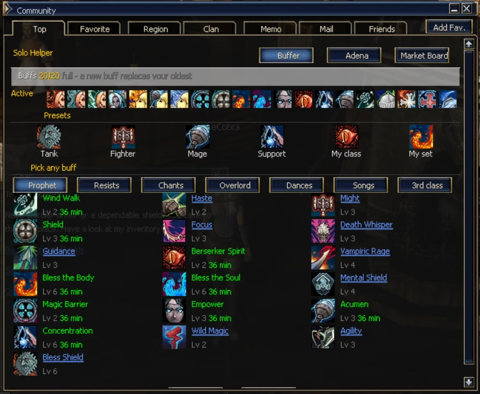
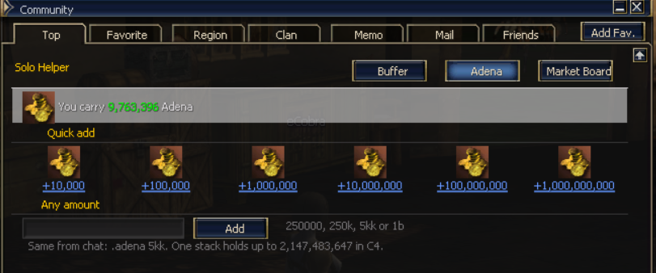

# Solo Helper for L2Solo: 1-hour buffs and Adena on Alt+B

Playing [L2Solo](https://github.com/pmbstyle/L2Solo) on your own and tired of running back to town for buffs? Solo Helper turns **Alt+B** into a full-width helper window with every C4 buff, one-click presets and an Adena tab. It's a small add-on for your own server. It stays in Chronicle 4: real C4 skills and icons, and the C4 20-buff limit.



## What you get

**Buffer tab**
- **85 C4 buffs at their max level**, in 7 tabs: Prophet, Resists, Chants, Overlord, Dances, Songs and 3rd class. Click the icon or the name.
- **One-click presets:** Tank, Fighter, Mage, Support, My class (picked for your class) and My set (your own saved list).
- **Every buff lasts 60 minutes** and survives a relog. Active buffs show in green with the minutes left.
- **Buttons:** Save my set, Buff servitor (when your summon is out) and Clear buffs (debuffs stay).
- **C4's 20-buff limit still applies.** When you're full, a new buff replaces your oldest.

**Adena tab**



- **Quick buttons** from +10,000 up to +1,000,000,000.
- **Type any amount** and press Add: `250000`, `1,000,000`, `250k`, `5kk` or `1b`.
- **One stack holds 2,147,483,647 at most**, the C4 limit.

**Chat commands**
- `.buffer` opens the window.
- `.adena 5kk` adds Adena straight away, and `.adena` alone opens the Adena tab.

**Market Board** is still one tab away: it's what Alt+B used to open.

## Install

Stop your server first. Then pick the way that matches how you installed L2Solo.

### A. You cloned L2Solo with git (easiest)

From your L2Solo folder:

```
git remote add solo-helper https://github.com/Arturas-Salivonas/L2Solo.git
git fetch solo-helper
git cherry-pick 27040e379..solo-helper/mine/solo-buffer
```

That copies only the Solo Helper commits onto whatever L2Solo version you're on (`main` or `develop`). Start the server as usual (`npm start`).

If git asks who you are, run `git config user.name "you"` and `git config user.email "you@example.com"` once, then the cherry-pick again.

### B. As a patch file

1. Download the patch: <https://github.com/Arturas-Salivonas/L2Solo/compare/27040e379...mine/solo-buffer.diff>
2. Save it in your L2Solo folder as `solo-helper.diff`.
3. Run:

```
git apply --check solo-helper.diff
git apply solo-helper.diff
```

If `--check` complains, your L2Solo is newer or older than the patch: use option A, or copy the files by hand (C).

### C. By hand (launcher installs, no git)

1. Download the branch as a zip (the whole server source, about 34 MB): <https://github.com/Arturas-Salivonas/L2Solo/archive/refs/heads/mine/solo-buffer.zip>
2. Copy these into the same places in your L2Solo server folder. All of them are new files, so nothing of yours is overwritten:
   - the whole folder `src/GameServer/Solo/`
   - `src/GameServer/World/Generics/NpcBypasses/Bbssolo.js`
   - `src/GameServer/World/Generics/NpcBypasses/SoloBuffer.js`
3. Change two lines of your own files:
   - In `src/GameServer/Network/Opcodes.js`, find
     ```
     table[0x57] = session => invoke('GameServer/AfkTrade/PlayerBoardWindow').open(session); // Board
     ```
     and replace it with
     ```
     table[0x57] = session => invoke('GameServer/Solo/SoloHelper').openBoard(session); // Board (solo helper, else Market Board)
     ```
   - In `src/GameServer/Network/Request/Speak.js`, find the `.menu` block in `dispatchLocalCommand` (it ends with `return true;` and `}`). Right after it, add
     ```
     if (invoke('GameServer/Solo/SoloHelper').command(session, data.text)) return true;
     ```
4. Don't copy the `tests/` files: the test runner only accepts tests it has listed.

**Heads-up:** the launcher's **Update / Verify server** puts back its own copy of those two edited files. After an update, Alt+B opens the Market Board again, so just redo step 3.

## Settings (optional)

All of these go in `config/local.ini`. Restart the server after a change.

```
[SoloHelper]
enabled = true        ; false turns the helper off (Alt+B = Market Board)
altB = true           ; false = Alt+B opens the Market Board again (.buffer still works)
buffMinutes = 60      ; how long helper buffs last, 1-1440
window = board        ; chat = a small chat window instead of the full board
adena = true          ; false hides the Adena tab and turns off .adena
```

Don't want free Adena? Set `adena = false`.

## Remove it

- **Git (A):** `git revert --no-edit 27040e379..solo-helper/mine/solo-buffer` undoes exactly those commits.
- **Patch (B):** `git apply -R solo-helper.diff`.
- **By hand (C):** put the two original lines back and delete the files you copied.

Your world and characters are never touched either way.

## Notes

- Made for solo play on your own server. Free buffs and Adena make the game much easier, which is the point when you play alone.
- Tested against L2Solo `develop` from late November 2026 with the C4 client.
- Bugs or ideas: open an issue on <https://github.com/Arturas-Salivonas/L2Solo>.
